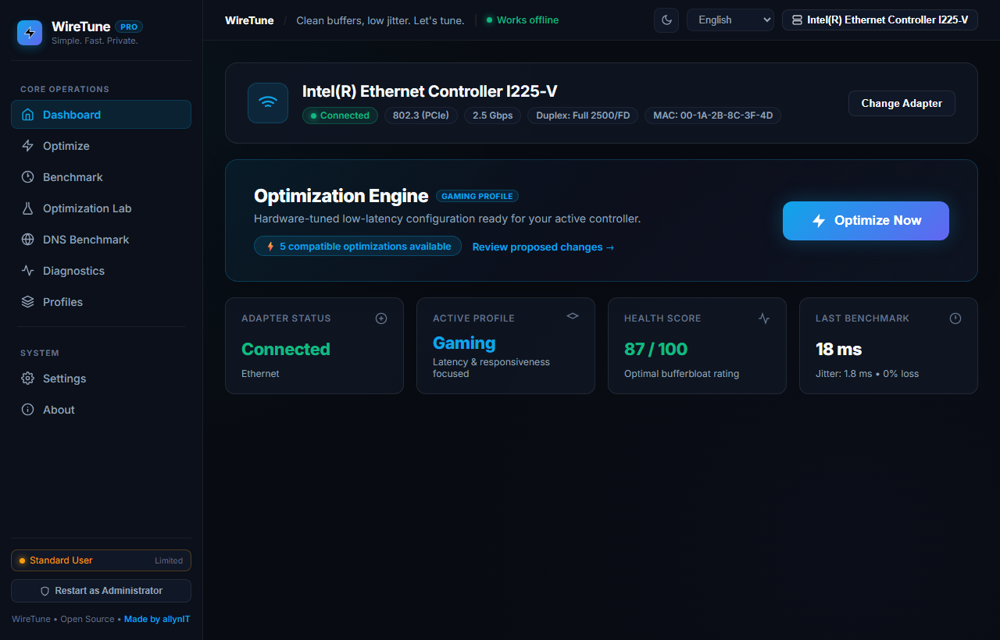
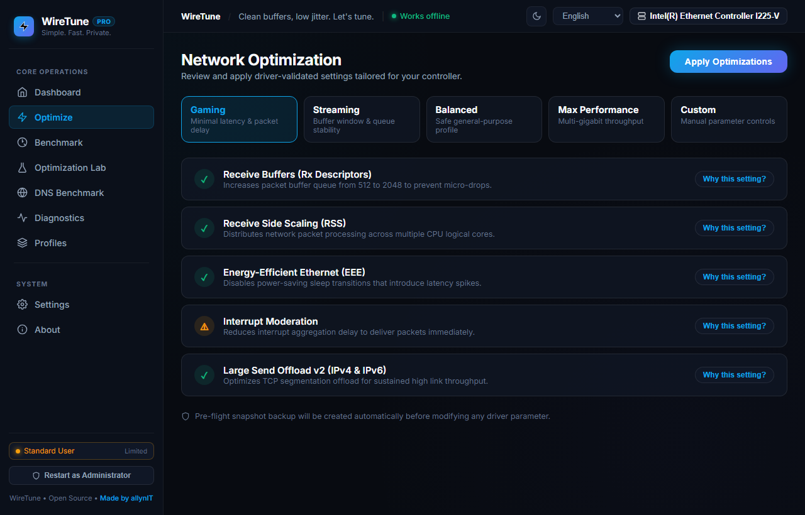
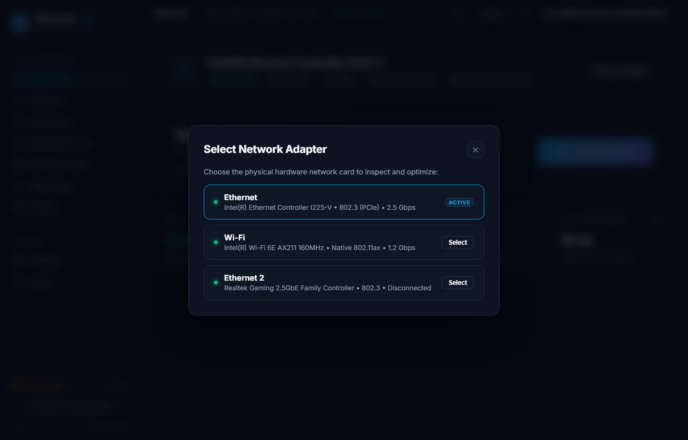
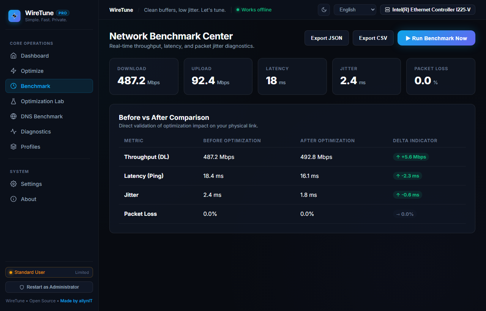
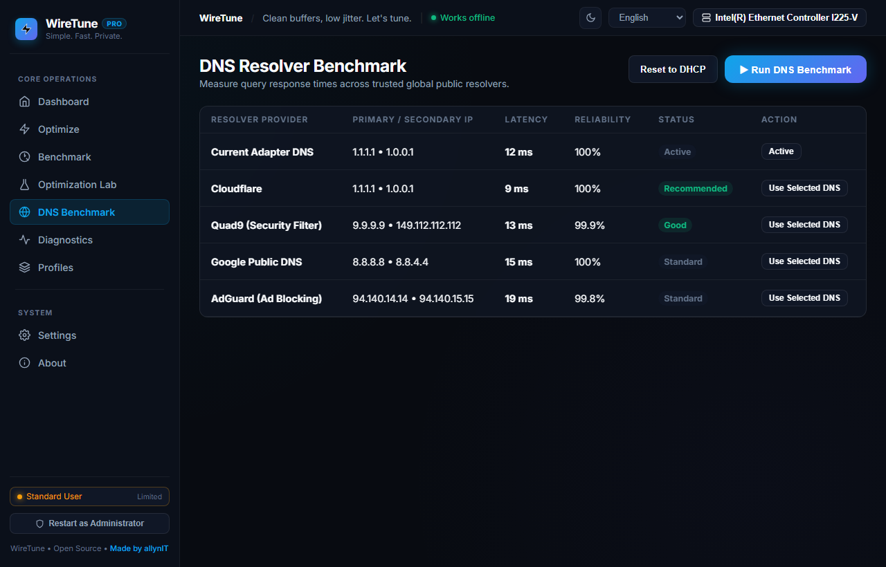
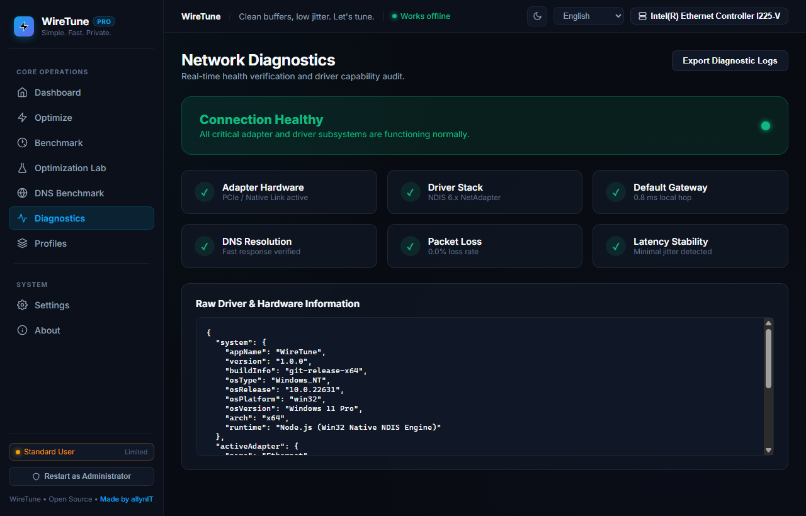
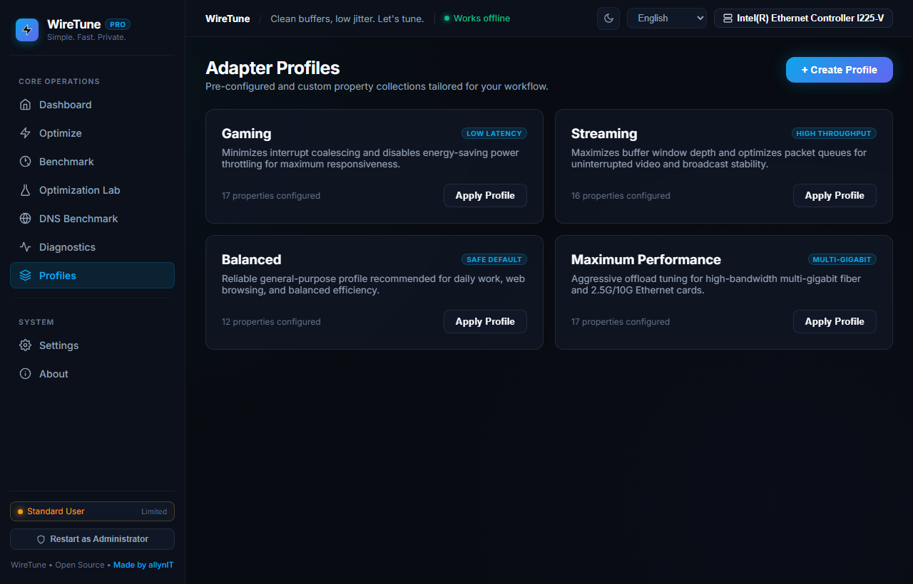
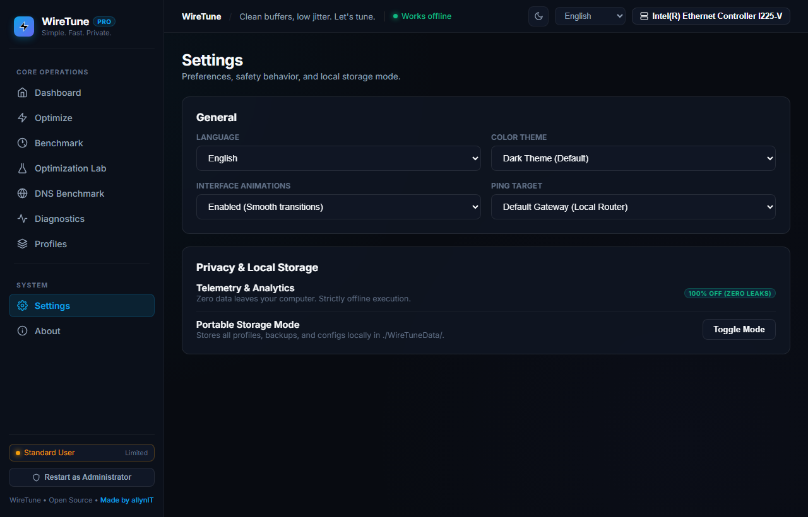
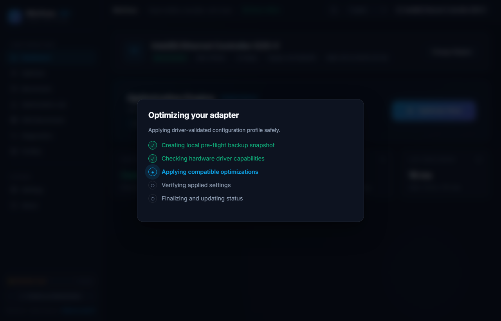

<div align="center">

# ⚡ WireTune

### *High-Performance Windows Network Latency Tuner & Driver Optimizer*

<p align="center">
  
  
  
  
  
  
</p>

<p align="center">
  <b>Minimalizacja opóźnień (jitter & ping) • Niskopoziomowy tuning właściwości NDIS • Bezpieczne migawki 1-Click Restore • Zero telemetrii</b>
</p>

<p align="center">
  <a href="#-demo-w-akcji">Demo w Akcji</a> •
  <a href="#-kluczowe-mozliwosci">Kluczowe Możliwości</a> •
  <a href="#-wiretune-vs-tradycyjne-skrypty-i-tweakery">Porównanie</a> •
  <a href="#-profile-optymalizacji">Profile</a> •
  <a href="#-zaawansowany-driver-tuning">Tuning NDIS</a> •
  <a href="#-benchmark-dns">Benchmark DNS</a> •
  <a href="#-jak-to-dziala-architektura">Architektura</a> •
  <a href="#-prywatnosc-i-bezpieczenstwo">Prywatność</a> •
  <a href="#-instalacja--uruchomienie">Instalacja</a> •
  <a href="#-faq">FAQ</a>
</p>

</div>

---

## 🎥 Demo w Akcji

<div align="center">
  
  <br /><br />
  <p>
    <em>Błyskawiczna, świadoma sprzętowo optymalizacja parametrów sieciowych z pełnym bezpieczeństwem i natychmiastowym cofaniem zmian.</em>
  </p>
</div>

---

## 🖥️ Główny Panel (Hero Dashboard)

<div align="center">
  
</div>

---

## ✨ Przegląd Modułów WireTune

WireTune pozwala na precyzyjne, bezpieczne i w 100% odwracalne dostosowanie parametrów karty sieciowej oraz stosu TCP/IP.

| Silnik Optymalizacji (Engine) | Szczegóły Karty Sieciowej (Adapter) |
| :---: | :---: |
|  |  |
| *Selektywne strojenie rejestru sterowników z wyjaśnieniami technicznymi "Dlaczego to ustawienie?".* | *Wykrywanie fizycznych interfejsów, negocjacja łącza, MAC oraz stan mediów.* |

| Centrum Benchmarku Sieci | Benchmark Resolverów DNS |
| :---: | :---: |
|  |  |
| *Testy pingu, fluktuacji (jitter) i stabilności pakietów z uczciwym porównaniem Przed / Po.* | *Pomiary opóźnień do czołowych resolverów DNS z ręcznym aplikowaniem 1 kliknięciem.* |

| Diagnostyka Sprzętowa | Własne Profile Karty |
| :---: | :---: |
|  |  |
| *Weryfikacja zdrowia połączenia i bezpośredni odczyt parametrów NDIS.* | *Gotowe presety dla Graczy, Streamerów oraz konfiguracje użytkownika.* |

| Ustawienia & Tryb Przenośny | Tryb Ciemny & Bezpieczna Aplikacja |
| :---: | :---: |
|  |  |
| *Wybór motywu Fluent, 30 języków oraz przełącznik Portable Mode (`./WireTuneData/`).* | *Wielostopniowy podgląd zmian z automatycznym tworzeniem kopii zapasowej JSON.* |

---

## 🎯 Kluczowe Możliwości

- 🚀 **Tuning Stosu Sieciowego & NDIS**: Optymalizacja parametrów karty na poziomie sprzętowym (Interrupt Moderation, RSS, EEE, Rx/Tx Descriptors, Checksum Offloading).
- 🎮 **Dedykowane Profile Konfiguracyjne**:
  - **Competitive Gaming**: Drastyczna redukcja fluktuacji opóźnień (jitter), wyłączenie uśpienia EEE, obniżenie interwałów przerwań procesora.
  - **Streaming & Content**: Zwiększona przepustowość, stabilne buforowanie TCP i akceleracja sprzętowa odciążeń pakietowych.
  - **Balanced / Default**: Zrównoważona praca na co dzień z zachowaniem energooszczędności.
  - **Maximum Performance**: Agresywne strojenie kolejek dla łączy gigabitowych i multi-gigabitowych (2.5G / 10G).
  - **Custom Profile Manager**: Możliwość tworzenia, eksportowania i importowania własnych profili ustawień.
- 🧪 **Rzetelny Benchmark Przed / Po**: Prawdziwe testy pingu do bramy/serwerów, pomiar rozrzutu opóźnień (jitter) oraz stabilności bez marketingowego zawyżania wyników.
- 🌐 **Benchmark Serwerów DNS**: Bezpośrednie testy latencji zapytań UDP do zaufanych resolverów (Cloudflare, Quad9, Google, AdGuard, OpenDNS, Mullvad) z 1-kliknięciowym zastosowaniem lub powrotem do DHCP.
- 💾 **Automatyczne Kopie Bezpieczeństwa (Pre-Flight Snapshots)**: Przed każdą zmianą WireTune automatycznie zapisuje pełną migawkę stanu sterownika w formacie JSON.
- ↩ **Błyskawiczny Rollback**: Możliwość natychmiastowego cofnięcia zmian lub przywrócenia fabrycznych wartości sterownika producenta.
- ❓ **Przejrzystość ("Dlaczego to ustawienie?")**: Szczegółowe podpowiedzi techniczne wyjaśniające wpływ każdego parametru na sprzęt i CPU.
- 🔒 **100% Prywatności & Działanie Offline**: Zero telemetrii, zero zewnętrznych serwerów analitycznych, bezpieczny proces działający wyłącznie na `127.0.0.1`.
- 📦 **Prawdziwy Tryb Portable**: Obsługa katalogu `./WireTuneData/` — brak wpisów do rejestru systemowego, gotowy do uruchomienia z pendrive'a.
- 🌍 **Obsługa 30 Języków**: Dynamiczna zmiana języka w czasie rzeczywistym z pełnym wsparciem dla układów RTL.

---

## ⚖️ WireTune vs. Tradycyjne Skrypty i "Tweakery"

Większość "optymalizatorów" z forów i filmików na YouTube to niebezpieczne skrypty `.bat` lub pliki `.reg`, które na ślepo wprowadzają wartości do rejestru, wyłączają zapory ogniowe lub psują Windows Defender. 

**WireTune działa w sposób bezpieczny i profesjonalny:**

| Cecha / Funkcjonalność | ⚠️ Zwykłe Skrypty & "Tweakery" | 🛡️ WireTune |
| :--- | :--- | :--- |
| **Weryfikacja Sterownika** | ❌ Na ślepo wpisuje klucze do rejestru bez sprawdzenia karty | ✅ Odpytuje sterownik o dozwolone wartości (`ValidDisplayValues`) |
| **Kopia Zapasowa Przed Zmianą** | ❌ Brak lub zawodny punkt przywracania systemu | ✅ Atomowa migawka JSON zapisywana przed każdą modyfikacją |
| **Możliwość Cofnięcia (Undo)** | ❌ Niemożliwe lub wymaga ręcznej reinstalacji sterownika | ✅ 1 kliknięcie cofa do dokładnego stanu sprzed optymalizacji |
| **Bezpieczeństwo Systemu** | ❌ Często wyłącza Windows Defender, firewall lub usługi | ✅ Zero ingerencji w antywirusa, firewall, proxy czy plik hosts |
| **Prywatność i Telemetria** | ❌ Bywa nośnikiem reklam, adware lub skryptów śledzących | ✅ 100% offline, zerowa telemetria, lokalne gniazdo loopback |
| **Sposób Aplikowania Zmian** | ❌ Wielokrotne restartowanie karty sieciowej dla każdego klucza | ✅ Zgrupowany, zoptymalizowany skrypt PowerShell (1–2 sekundy) |
| **Wyjaśnienia Techniczne** | ❌ Ukryte, nieudokumentowane manipulacje rejestrem | ✅ "Dlaczego to ustawienie?" – pełna transparentność wpływu na CPU |
| **Obsługa DNS** | ❌ Podmienia DNS w tle bez zgody użytkownika | ✅ Transparentny benchmark; zmiana tylko na wyraźne żądanie |
| **Świadomość Sprzętowa** | ❌ Traktuje Intel, Realtek, Marvell i Wi-Fi jednakowo | ✅ Rozpoznaje producenta, typ medium i unikalne możliwości karty |

---

## 🎛️ Profile Optymalizacji

| Profil | Dla Kogo? | Cel Główny | Kluczowe Modyfikacje |
| :--- | :--- | :--- | :--- |
| **Balanced** | Codzienna praca i internet | Stabilność & Oszczędność Energii | Bezpieczne ustawienia domyślne, zrównoważona moderacja przerwań. |
| **Gaming** | Gracze turniejowi (FPS / MOBA) | Najniższy Ping & Minimalny Jitter | Wyłączenie Energy Efficient Ethernet (EEE), minimalizacja opóźnień przerwań, dedykowane kolejki RSS. |
| **Streaming** | Twórcy treści & Streaming 4K | Płynna Przepustowość & Zero Dropów | Powiększone okna buforów TCP, aktywne odciążenia sprzętowe LSO, stabilizacja bufora. |
| **Maximum Performance** | Łącza Multi-Gigabit (2.5G / 10G) | Maksymalny Transfer i Wydajność ASIC | Zwiększenie deskryptorów Rx/Tx, obsługa ramek Jumbo, agresywny hardware offload. |
| **Custom** | Zaawansowani administratorzy | Pełna Kontrola Manualna | Indywidualne włączanie/wyłączanie dowolnej właściwości udostępnianej przez sterownik. |

---

## 🔬 Zaawansowany Driver Tuning

WireTune komunikuje się bezpośrednio z podsystemem NDIS oraz modułem `NetAdapter` systemu Windows:

```
┌────────────────────────────────────────────────────────────────────────┐
│                        KARTA SIECIOWA (FIZYCZNA)                       │
├──────────────────────────────────┬─────────────────────────────────────┤
│  ⚡ Interrupt Moderation (IM)    │  Kontrola częstotliwości przerwań   │
│  🍃 Energy Efficient Ethernet    │  Zapobieganie usypianiu łącza PHY   │
│  🔀 Receive Side Scaling (RSS)   │  Rozkład obsługi pakietów na rdzenie│
│  📦 Rx / Tx Buffer Descriptors   │  Eliminacja utraty pakietów w piku  │
│  🚀 Large Send Offload (LSO v2)  │  Segmentacja pakietów na chipsecie  │
│  🛡️ TCP/UDP Checksum Offload     │  Sprzętowe liczenie sum kontrolnych │
│  🌊 Flow Control (Sterowanie)    │  Kontrola zatorów bufora przełącznika│
│  🐘 Jumbo Frame Packets          │  Większe MTU w sieciach lokalnych   │
└──────────────────────────────────┴─────────────────────────────────────┘
```

- **Interrupt Moderation (Moderacja Przerwań)**: Zapobiega zalewaniu procesora przerwaniami przy każdym pakiecie. Dla gamingu obniżenie wartości zmniejsza opóźnienie reakcji, natomiast dla transferów masowych redukuje obciążenie CPU.
- **Energy Efficient Ethernet (EEE / Green Ethernet)**: Usypia tor transmisyjny karty przy braku ruchu. Wyłączenie EEE zapobiega mikro-przycięciom i opóźnieniom wzbudzania łącza.
- **Receive Side Scaling (RSS)**: Rozdziela przetwarzanie ruchu sieciowego na wiele rdzeni CPU, zapobiegając przeciążeniu pierwszego rdzenia (Core 0).
- **Deskryptory Rx / Tx**: Pamięć podręczna na samej karcie sieciowej. Wyższe wartości zapobiegają gubieniu pakietów podczas gwałtownych obciążeń.
- **Odciążenia Sprzętowe (Checksum / LSO)**: Przenoszą kosztowne obliczenia sum kontrolnych oraz podziału dużych ramek z procesora bezpośrednio na układ scalony karty sieciowej.

---

## 🌐 Benchmark DNS

WireTune pozwala zmierzyć faktyczną szybkość odpowiedzi serwerów DNS bezpośrednio z Twojego komputera za pomocą standardowych zapytań UDP:

| Dostawca DNS | Adres Podstawowy | Adres Zapasowy | Charakterystyka |
| :--- | :--- | :--- | :--- |
| **Cloudflare** | `1.1.1.1` | `1.0.0.1` | Ekstremalnie szybki Anycast, rygorystyczna polityka braku logów |
| **Quad9** | `9.9.9.9` | `149.112.112.112` | Automatyczne blokowanie domen ze złośliwym oprogramowaniem |
| **Google Public DNS** | `8.8.8.8` | `8.8.4.4` | Najwyższa globalna dostępność i niezawodność infrastruktury |
| **AdGuard DNS** | `94.140.14.14` | `94.140.15.15` | Ochrona przed reklamami, trackerami i domenami śledzącymi |
| **OpenDNS** | `208.67.222.222` | `208.67.220.220` | Stabilny resolver klasy korporacyjnej |
| **Mullvad** | `194.242.2.2` | `194.242.2.3` | Skupiony na prywatności, brak jakiejkolwiek analizy zapytań |

> [!IMPORTANT]
> **Pełna Kontrola**: WireTune **nigdy** nie zmienia konfiguracji DNS bez Twojej zgody. Wybór serwera należy do Ciebie, a przywrócenie automatycznego DNS (DHCP) odbywa się jednym kliknięciem.

---

## 🔄 Jak to Działa? (Architektura)

```
┌──────────────────────────────┐
│     1. Wykrycie Sprzętu      │  → Odczyt fizycznych kart LAN i Wi-Fi przez NDIS
└──────────────┬───────────────┘
               │
┌──────────────▼───────────────┐
│     2. Badanie Sterownika    │  → Odczyt właściwości oraz puli ValidDisplayValues
└──────────────┬───────────────┘
               │
┌──────────────▼───────────────┐
│     3. Migawka JSON Backup   │  → Zapis oryginalnego stanu do ./backups/
└──────────────┬───────────────┘
               │
┌──────────────▼───────────────┐
│     4. Filtr Zgodności       │  → Odrzucenie opcji nieobsługiwanych przez sterownik
└──────────────┬───────────────┘
               │
┌──────────────▼───────────────┐
│     5. Skrypt Zbiorczy       │  → Aplikacja wszystkich zmian w 1 wywołaniu PowerShell
└──────────────┬───────────────┘
               │
┌──────────────▼───────────────┐
│     6. Weryfikacja Sprzętowa │  → Potwierdzenie przyjęcia parametrów przez kartę
└──────────────┬───────────────┘
               │
               ▼
   [ Sukces • Gotowy Rollback ]
```

---

## 🔒 Prywatność i Bezpieczeństwo

Gwarancje bezpieczeństwa WireTune:
- **Zero telemetrii**: Brak zewnętrznych bibliotek analitycznych (Google Analytics, Sentry, Mixpanel, itp.).
- **Brak połączeń wychodzących**: Aplikacja komunikuje się wyłącznie lokalnie na adresie `127.0.0.1`.
- **Brak rejestracji**: Brak kont, logowania czy wymogu podawania adresu e-mail.
- **Pełna przejrzystość**: Wszystkie kopie zapasowe to czytelne pliki JSON na Twoim dysku.
- Zapoznaj się z pełną [Polityką Prywatności (PRIVACY.md)](PRIVACY.md).

---

## 🛠️ Instalacja & Uruchomienie

### Opcja 1: Wersja Przenośna (Najszybsza)
1. Pobierz najnowsze wydanie z zakładki [Releases](https://github.com/allynIT/WireTune/releases).
2. Rozpakuj archiwum w dowolnym folderze lub na pendrive.
3. Uruchom `WireTune.exe` (lub kliknij prawym przyciskiem `WireTune-Admin.bat` i wybierz **Uruchom jako administrator**).

### Opcja 2: Uruchomienie ze Źródeł (Node.js)

#### Wymagania
- **Windows 10 / 11** (64-bit)
- **Node.js 18.0+**
- **PowerShell 5.1+**

```bash
# 1. Sklonuj repozytorium
git clone https://github.com/allynIT/WireTune.git
cd WireTune

# 2. Uruchom zestaw testów automatycznych (15 testów)
npm test

# 3. Uruchom aplikację
npm start

# (Opcjonalnie) Skompiluj natywną aplikację WireTune.exe (.NET 8 WebView2)
npm run build:exe
```

---

## ❓ FAQ (Najczęściej Zadawane Pytania)

<details>
<summary><strong>Czy WireTune gwarantuje niższy ping w każdej grze?</strong></summary>
<br />
<strong>Nie ma cudów:</strong> fizycznego dystansu do serwera gry ani parametrów Twojego łącza światłowodowego/radiowego nie da się zmienić oprogramowaniem. WireTune eliminuje natomiast wąskie gardła po stronie komputera i sterownika: zapobiega uśpieniu karty, minimalizuje fluktuacje opóźnień (jitter), usuwa micro-stuttery i optymalizuje obsługę przerwań przez CPU.
</details>

<details>
<summary><strong>Czy mogę bezpiecznie cofnąć wszystkie zmiany?</strong></summary>
<br />
<strong>Tak, w 100%.</strong> Przed każdą zmianą WireTune wykonuje lokalną migawkę JSON. Możesz przywrócić dowolny wcześniejszy stan jednym kliknięciem w zakładce <em>Historia Audytu</em> lub zresetować kartę do ustawień fabrycznych producenta.
</details>

<details>
<summary><strong>Dlaczego aplikacja wymaga uprawnień administratora?</strong></summary>
<br />
System Windows ze względów bezpieczeństwa blokuje zwykłym użytkownikom możliwość modyfikacji sterowników sprzętowych i stosu sieciowego. Uprawnienia administratora są niezbędne wyłącznie do zapisania zmian w karcie. W trybie zwykłego użytkownika WireTune działa w trybie podglądu (Read-Only).
</details>

<details>
<summary><strong>Czy WireTune podmienia sterownik karty sieciowej?</strong></summary>
<br />
<strong>Nie.</strong> WireTune nie instaluje żadnych niepodpisanych czy obcych sterowników. Konfiguruje jedynie oficjalne właściwości udostępnione przez producenta Twojego chipsetu (Intel, Realtek, Marvell itp.) za pośrednictwem oficjalnego API Windows.
</details>

<details>
<summary><strong>Dlaczego połączenie na chwilę znika podczas optymalizacji?</strong></summary>
<br />
Niektóre kluczowe zmiany sprzętowe (np. zmiana liczby kolejek RSS lub moderacji przerwań) wymagają od systemu Windows 1-2 sekundowej re-inicjalizacji interfejsu sieciowego. Jest to w pełni naturalne zachowanie stosu NDIS.
</details>

---

## 🗺️ Roadmapa Rozwoju

- [x] Detekcja adapterów fizycznych przez podsystem Windows NetAdapter
- [x] Dedykowane profile optymalizacyjne (`Gaming`, `Streaming`, `Balanced`, `Maximum Performance`)
- [x] Atomowy system tworzenia migawek JSON i natychmiastowego rollbacku
- [x] Centrum Benchmarku Latencji, Jittera i Przepustowości Przed / Po
- [x] Benchmark Resolverów DNS z ręcznym aplikowaniem
- [x] Menadżer profili własnych (eksport / import JSON)
- [x] Transparentne opisy techniczne ("Dlaczego to ustawienie?")
- [x] Architektura 100% Offline & Zero Telemetrii
- [x] Tryb Portable Mode (`./WireTuneData/`)
- [x] 30 wersji językowych z dynamicznym przełączaniem i obsługą RTL
- [x] Interfejs Windows 11 Fluent Design (Dark & Light Mode)
- [x] Zgrupowany skrypt wsadowy PowerShell przyspieszający aplikację zmian do 1-2 sekund
- [~] Rozszerzona heurystyka dla kart 2.5GbE / 10GbE (Intel Killer, Realtek Gaming, Marvell AQtion)
- [ ] Automatyczne przełączanie profilu przy zmianie sieci (np. LAN w domu vs Wi-Fi w podróży)
- [ ] Analizator zniekształceń buforowania (Bufferbloat Analyzer) i diagnostyka SNR Wi-Fi

---

## 🤝 Współpraca (Contributing)

Chcesz pomóc w rozwoju WireTune? Przeczytaj [CONTRIBUTING.md](CONTRIBUTING.md).

1. Sforkuj repozytorium
2. Stwórz gałąź funkcyjną (`git checkout -b feature/nowa-funkcja`)
3. Zatwierdź zmiany (`git commit -m 'feat: dodanie nowej funkcji'`)
4. Wyślij na branch (`git push origin feature/nowa-funkcja`)
5. Otwórz Pull Request

---

## 📄 Licencja

Projekt WireTune jest udostępniony na warunkach otwartoźródłowej licencji **[MIT License](LICENSE)**.

---

<div align="center">

Stworzone z pasją przez **[allynIT](https://github.com/allynIT)** ⚡  
*WireTune • Safe, Fast & Transparent Network Optimization*

</div>
