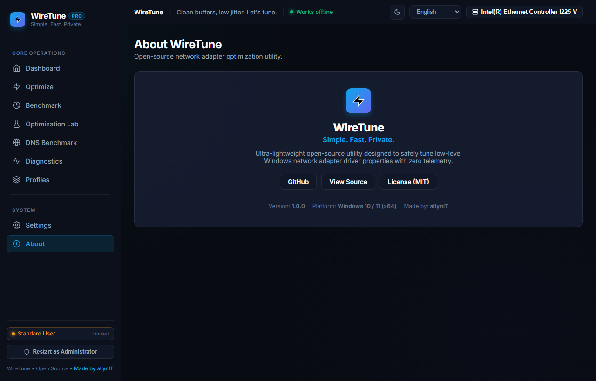

<div align="center">

# WireTune

### Simple. Fast. Private.

**A lightweight open-source network adapter optimization utility.**

[](LICENSE)
[](https://github.com/allynIT/WireTune)
[](https://github.com/allynIT/WireTune)
[](https://github.com/allynIT/WireTune/actions)
[](https://github.com/allynIT/WireTune)

<br />

<p align="center">
  <a href="#-quick-start">Quick Start</a> •
  <a href="#-features">Features</a> •
  <a href="#-how-it-works">How It Works</a> •
  <a href="#-optimization-profiles">Profiles</a> •
  <a href="#-privacy-by-design">Privacy</a> •
  <a href="#-roadmap">Roadmap</a>
</p>

</div>

---

## 🎥 Watch WireTune in Action

<div align="center">
  
  <br /><br />
  <p>
    <em>Experience ultra-fast, hardware-aware network optimization with zero telemetry.</em>
  </p>
</div>

---

## 🖥️ Hero Dashboard

<div align="center">
  
</div>

---

## ✨ WireTune at a Glance

WireTune empowers you to fine-tune your network adapter's low-level driver properties safely, transparently, and reversibly.

| Optimization Engine | Adapter Intelligence |
| :---: | :---: |
|  |  |
| *Granular driver property tuning with contextual "Why this setting?" explanations.* | *Physical network card selector with live link speed, media type, and MAC status.* |

| Network Benchmark Center | DNS Resolver Benchmark |
| :---: | :---: |
|  |  |
| *Real-time ping, jitter, and link speed testing with honest Before vs After comparisons.* | *Measure latency and reliability across top public resolvers with 1-click manual apply.* |

| Network Diagnostics | Adapter Profiles |
| :---: | :---: |
|  |  |
| *6-point connection health verification and raw hardware/driver NDIS telemetry.* | *Tailored presets for Gaming, Streaming, Balanced, and Multi-Gigabit Performance.* |

| Application Settings | Elevated Modal Experience |
| :---: | :---: |
|  |  |
| *Comprehensive preferences: Theme, Language, Reduce Motion, and Portable storage mode.* | *Multi-step animated pre-flight backup snapshot and verified optimization progress.* |

---

## ⚡ Features

### 🚀 Core Capabilities
- **⚡ One-Click Optimization**: Apply tuned network settings tailored to your hardware in a single click.
- **🧠 Smart Adapter Detection**: Automatically enumerates physical Ethernet and Wi-Fi adapters using native Windows APIs.
- **🎮 Optimization Profiles**: Choose between `Balanced`, `Gaming`, `Streaming`, `Maximum Performance`, or `Custom`.
- **🧪 Before / After Benchmark**: Test connection latency, jitter, and packet loss before and after modifications.
- **🌐 DNS Benchmark**: Measure resolution latency across major public resolvers and apply the fastest match.
- **💾 Automatic Local Backups**: Every optimization automatically saves a timestamped snapshot before making changes.
- **↩ One-Click Restore**: Instantly roll back to previous settings or reset to manufacturer defaults.
- **🧩 Custom Adapter Profiles**: Build, name, export, and apply custom property configurations.
- **❓ "Why this setting?" Tooltips**: Contextual documentation explaining what each property does, benefits, and trade-offs.

### 🛡️ System & Diagnostics
- **🩺 Network Diagnostics**: View link speed, MAC address, driver version, media type, and connection status.
- **📊 Real-time Monitoring**: Monitor physical adapter status and live link negotiation.
- **🌍 Multi-Language Interface**: Comprehensive support for 30 languages with native RTL rendering.
- **🎨 Fluent Design UI**: Modern Windows 11 interface with Dark and Light mode support.
- **📦 Portable Mode**: Run completely self-contained without installation or system registry writes.
- **🔒 Privacy-First Architecture**: 100% offline-capable with zero external telemetry or analytics.

---

## 💡 Why WireTune?

Most network "tweakers" apply obscure, dangerous registry scripts that disable critical Windows security features or apply identical settings across incompatible hardware. 

**WireTune takes the opposite approach:**
- **Driver-Aware**: Checks your actual network card driver to discover which properties and enum values are legitimately supported.
- **Safe by Default**: If a property cannot be safely verified against driver capabilities, WireTune skips it.
- **100% Reversible**: Every change is backed up locally before application.
- **Transparent**: No hidden registry hacks, no firewall tampering, and no disabling of Windows Defender.
- **No False Promises**: WireTune does not promise impossible latency reductions. Results depend on your physical hardware, router, driver, ISP, and network conditions.

---

## 🔄 How It Works

```
┌──────────────────────┐
│  1. Detect Adapter   │  → Scans physical Ethernet and Wi-Fi controllers
└──────────┬───────────┘
           │
┌──────────▼───────────┐
│  2. Query Driver     │  → Reads current registry keys and advanced properties
└──────────┬───────────┘
           │
┌──────────▼───────────┐
│  3. Probe Limits     │  → Enumerates supported enum options (ValidDisplayValues)
└──────────┬───────────┘
           │
┌──────────▼───────────┐
│  4. Create Backup    │  → Saves a complete snapshot to ./WireTuneData/backups/
└──────────┬───────────┘
           │
┌──────────▼───────────┐
│  5. Select Profile   │  → Matches profile targets against valid hardware values
└──────────┬───────────┘
           │
┌──────────▼───────────┐
│  6. Apply & Verify   │  → Modifies only verified properties via Windows NetAdapter
└──────────┬───────────┘
           │
┌──────────▼───────────┐
│  7. Benchmark        │  → Evaluates latency, jitter, and link responsiveness
└──────────┬───────────┘
           │
           ▼
        [ Done ]
```

1. **Detect Adapter**: Automatically discovers active network controllers and driver identifiers.
2. **Check Driver**: Queries low-level properties exposed by the manufacturer driver.
3. **Detect Capabilities**: Identifies accepted keywords and supported value ranges.
4. **Create Backup**: Writes an uncompressed JSON snapshot before making any modifications.
5. **Select Profile**: Filters profile parameters to match only compatible hardware properties.
6. **Apply Compatible Changes**: Safely applies validated values through PowerShell NetAdapter cmdlets.
7. **Verify**: Confirms applied values against current driver state.
8. **Benchmark**: Measures connection latency and jitter to verify link quality.
9. **Done**: Displays optimization audit report with instant undo available.

---

## 🎛️ Optimization Profiles

| Profile | Target Audience | Primary Focus | Key Adjustments |
| :--- | :--- | :--- | :--- |
| **Balanced** | Everyday Users | Stability & Energy Efficiency | Safe defaults, mild interrupt moderation, standard buffer sizing. |
| **Gaming** | Competitive Gamers | Minimal Latency & Responsiveness | Disables Energy Efficient Ethernet, lowers interrupt delays, optimizes RSS queues. |
| **Streaming** | Content Creators & Media | Throughput & Buffer Stability | Maximizes TCP buffer windows, enables hardware checksum offloads, stabilizes queues. |
| **Maximum Performance** | Multi-Gigabit Links | High-Bandwidth Throughput | Maximizes Rx/Tx descriptors, enables jumbo frames (where supported), aggressive offloading. |
| **Custom** | Advanced Users & Admins | Granular Manual Control | Allows individual toggle and configuration of any driver-exposed property. |

---

## 📊 Before / After Benchmark

The integrated **Network Benchmark Center** measures:
- **Download / Upload Throughput**: Data transfer capacity.
- **Latency (Ping)**: Round-trip time to your local gateway or designated endpoint.
- **Jitter**: Latency variation across consecutive packets.
- **Packet Loss**: Percentage of dropped packets during stress tests.
- **Link Speed**: Hardware negotiated physical link rate (e.g., 1 Gbps, 2.5 Gbps).
- **Stability Rating**: Overall connection consistency score.

> [!NOTE]
> *Benchmark results depend on your hardware, network adapter driver, local router, ISP, and testing environment. WireTune provides honest measurements without artificial inflation.*

---

## 🌐 DNS Resolver Benchmark

WireTune includes an independent DNS latency and reliability benchmark:
- **Direct Queries**: Performs standard UDP DNS lookups directly to resolver server IPs.
- **Major Resolvers Supported**: Cloudflare (`1.1.1.1`), Quad9 (`9.9.9.9`), Google (`8.8.8.8`), OpenDNS (`208.67.222.222`), AdGuard (`94.140.14.14`), Mullvad (`194.242.2.2`).
- **Metrics Tracked**: Query response time (ms), variance, and resolution reliability (%).
- **Manual Control**: WireTune will **never** alter your DNS settings in the background. You manually select which resolver to apply or reset back to automatic DHCP at any time.

---

## ❓ "Why this setting?" Transparency

WireTune does not treat network parameters as a black box. In the **Adapter Details** view, clicking **"Why this setting?"** on any property reveals:
- **Technical Definition**: What the parameter controls at the hardware/OS level.
- **WireTune Recommendation**: Why a specific value is suggested for your active profile.
- **Potential Benefits**: Reduced latency, higher throughput, or lower CPU overhead.
- **Potential Trade-offs**: Slightly higher power consumption or increased CPU interrupts.
- **Driver Dependency**: Whether the property relies on Intel, Realtek, or vendor-specific drivers.

---

## 🔒 Privacy by Design

WireTune is built on the belief that system optimization utilities should **never** monitor their users.

```
┌────────────────────────────────────────────────────────┐
│               WIRE TUNE PRIVACY GUARANTEE               │
├────────────────────────────────────────────────────────┤
│  ✓  No telemetry                                       │
│  ✓  No analytics                                       │
│  ✓  No tracking scripts or beacons                     │
│  ✓  No advertising or sponsored links                  │
│  ✓  No account registration required                   │
│  ✓  No cloud backend or remote servers                 │
│  ✓  No hidden background data collection               │
│  ✓  No automatic crash or log uploads                  │
│  ✓  100% offline-capable execution                     │
└────────────────────────────────────────────────────────┘
```

All operations, benchmarks, and configuration adjustments run purely on your local machine.

---

## 🛡️ Safe by Default

> **"If WireTune cannot verify it, WireTune does not change it."**

- **Pre-Flight Snapshots**: A JSON backup is automatically saved before modifying any setting.
- **Capability Filtering**: Proposed settings are validated against the driver's accepted enum values (`ValidDisplayValues`). Incompatible options are skipped safely.
- **One-Click Rollback**: Restore any previous configuration state directly from the **Audit History** tab.
- **Factory Reset**: Restore original adapter defaults at any time.
- **No System Tampering**: WireTune never modifies Windows Defender, firewall rules, hosts files, or proxy servers.

---

## 📦 Portable Mode

WireTune natively supports **Portable Mode** without requiring installation:
- When Portable Mode is active, all application settings, backup snapshots, and custom profiles are stored in:
  ```
  ./WireTuneData/
  ├── backups/
  ├── profiles/
  └── config.json
  ```
- No registry keys or `%APPDATA%` folders are created or modified.
- Easily toggle between Portable Mode and Standard Mode directly from **Settings**.

---

## 🚀 Quick Start

### Option 1: Standalone Portable (Recommended)
1. Download the latest release package from [Releases](https://github.com/allynIT/WireTune/releases).
2. Extract the archive to any folder or USB drive.
3. Launch `WireTune.exe` (or run `WireTune-Admin.bat` for administrator privileges).

### Option 2: Build from Source

#### Prerequisites
- **Windows 10** or **Windows 11** (64-bit)
- **Node.js 18.0+**
- **PowerShell 5.1+**
- *(Optional for .NET desktop wrapper)*: **.NET 8.0 SDK**

#### Steps
```bash
# 1. Clone the repository
git clone https://github.com/allynIT/WireTune.git
cd WireTune

# 2. Run automated tests
npm test

# 3. Start the application
npm start

# (Optional) Build standalone WireTune.exe executable
npm run build:exe
```

---

## 📖 Usage Walkthrough

1. **Launch WireTune**: Start the application with administrator privileges when applying hardware changes.
2. **Select Adapter**: Choose the target physical network interface from the dropdown (e.g., Ethernet or Wi-Fi).
3. **Choose a Profile**: Select an optimization profile (`Balanced`, `Gaming`, `Streaming`, `Maximum Performance`, or `Custom`).
4. **Run Baseline Benchmark**: Use the **Benchmark** tab to record your pre-optimization baseline.
5. **Review Proposed Changes**: Click **Adapter Details** to inspect current values and "Why this setting?" explanations.
6. **Automatic Backup**: WireTune automatically captures a timestamped backup before applying changes.
7. **Optimize**: Click **Optimize Now** to apply driver-validated settings.
8. **Run Post-Optimization Benchmark**: Compare latency, jitter, and throughput against your baseline.
9. **Inspect Audit History**: Review applied changes in the **Audit History** tab.
10. **Restore if Necessary**: Revert to the pre-optimization snapshot with a single click if desired.

---

## 💻 Supported Platforms

- **Windows 11** (All Editions, 64-bit)
- **Windows 10** (Version 1903 or newer, 64-bit)
- *Architecture*: x64 / ARM64 (emulated)

---

## 🏗️ Architecture

WireTune follows a decoupled, modular architecture with zero external runtime dependencies:

```
┌────────────────────────────────────────────────────────┐
│                   UI Layer (HTML5/CSS/JS)              │
│       Fluent Design System • Responsive Views • i18n   │
└───────────────────────────┬────────────────────────────┘
                            │ (Local IPC / Loopback HTTP)
┌───────────────────────────▼────────────────────────────┐
│                    WireTune Core Engine                │
├────────────────────────────────────────────────────────┤
│  ├── Adapter Manager      (Hardware discovery)         │
│  ├── Optimization Engine  (Profile verification)       │
│  ├── Benchmark Engine     (Latency & jitter testing)   │
│  ├── DNS Benchmark        (Resolver testing)           │
│  ├── Backup & Restore     (Local JSON snapshotting)    │
│  ├── Custom Profiles      (User presets manager)       │
│  ├── Diagnostics Tool     (System hardware audit)      │
│  └── Localization Engine  (30 languages support)       │
└───────────────────────────┬────────────────────────────┘
                            │
┌───────────────────────────▼────────────────────────────┐
│             Platform Layer (Windows / PowerShell)      │
│     NetAdapter Subsystem • TCP Stack • Registry Hooks  │
└────────────────────────────────────────────────────────┘
```

---

## 📸 Screenshots Gallery

| Dashboard Overview | Adapter Advanced Properties |
| :---: | :---: |
|  |  |

| Profile Customizer | Network Benchmark Center |
| :---: | :---: |
|  |  |

| Settings & Storage Mode | About & System Diagnostics |
| :---: | :---: |
|  |  |

---

## ❓ Frequently Asked Questions (FAQ)

<details>
<summary><strong>Does WireTune guarantee lower ping or faster internet?</strong></summary>
<br />
<strong>No.</strong> WireTune optimizes local network adapter driver behavior (such as interrupt moderation, energy-saving transitions, and TCP buffer sizing). While this can reduce packet jitter, bufferbloat, and micro-stutters, your overall bandwidth and ping are ultimately constrained by your ISP, router, and physical connection.
</details>

<details>
<summary><strong>Does WireTune collect or transmit my data?</strong></summary>
<br />
<strong>No.</strong> WireTune contains zero telemetry, zero analytics, zero advertising, and zero external tracking scripts. All operations run 100% locally on your machine.
</details>

<details>
<summary><strong>Can I undo changes made by WireTune?</strong></summary>
<br />
<strong>Yes.</strong> WireTune automatically creates a local JSON snapshot before any modification. You can revert to any prior state or restore original factory defaults with a single click.
</details>

<details>
<summary><strong>Does WireTune work completely offline?</strong></summary>
<br />
<strong>Yes.</strong> WireTune does not require an active internet connection to discover adapters, apply profiles, or manage backups.
</details>

<details>
<summary><strong>Does WireTune replace my network adapter driver?</strong></summary>
<br />
<strong>No.</strong> WireTune configures the official driver properties provided by the hardware manufacturer (e.g., Intel, Realtek). It does not install third-party drivers or custom kernel extensions.
</details>

<details>
<summary><strong>Can I customize individual settings manually?</strong></summary>
<br />
<strong>Yes.</strong> The <code>Custom</code> profile and <strong>Adapter Details</strong> view allow you to inspect and modify individual properties exposed by your network card.
</details>

---

## 🔧 Troubleshooting

| Issue | Potential Cause | Solution |
| :--- | :--- | :--- |
| **Adapter not detected** | Adapter is disabled or driver missing | Ensure the adapter is enabled in Windows Device Manager and official drivers are installed. |
| **Setting unavailable** | Driver does not expose this feature | Some low-end or generic drivers do not expose advanced features (e.g., RSS, EEE). WireTune automatically hides or skips unsupported settings. |
| **Optimization failed** | Missing administrator rights | Run WireTune with administrator privileges by clicking **Restart as Administrator** or using `WireTune-Admin.bat`. |
| **Connection dropped temporarily** | Adapter resetting after property change | Applying certain advanced driver properties causes the network card to briefly re-initialize (1–2 seconds). This is normal Windows behavior. |

---

## 🗺️ Roadmap

WireTune is actively evolving. The roadmap represents planned ideas and may change as the project grows.

### 📌 v1.x — Foundation
- [x] Hardware adapter detection via Windows NetAdapter subsystem
- [x] Optimization profiles (`Balanced`, `Gaming`, `Streaming`, `Maximum Performance`)
- [x] Automated pre-flight local JSON backups and rollback system
- [x] Integrated Before / After Network Benchmark Center
- [x] DNS Resolver Benchmark with 1-click manual apply
- [x] Custom Adapter Profiles manager (create, save, export)
- [x] Contextual "Why this setting?" technical explanations
- [x] 100% Offline, Zero Telemetry architecture
- [x] Portable Mode with self-contained `./WireTuneData/` storage
- [x] Multi-language localization across 30 languages
- [x] Windows 11 Fluent Design UI with Dark & Light mode

### 🚀 v2.x — Advanced Optimization
- [~] Expanded vendor-specific property mappings (Intel Killer, Realtek Gaming, Marvell AQtion)
- [~] Advanced driver capability detection and hardware limitation heuristics
- [ ] Smarter per-adapter profile recommendation engine based on link type
- [ ] Per-adapter profiles with automatic switching on network change
- [ ] Multi-point configuration rollback history with side-by-side diffing
- [ ] Automatic post-apply configuration verification and health check
- [ ] A/B profile performance testing mode
- [ ] More detailed network diagnostics (DPC latency indicators, packet drop counters)
- [ ] Enhanced benchmark accuracy with multi-pass median filtering

### 🧠 v3.x — Network Intelligence
- [ ] Intelligent physical link quality analysis
- [ ] Network bufferbloat and queue depth analyzer
- [ ] Wi-Fi quality and signal-to-noise ratio (SNR) diagnostics
- [ ] Wi-Fi channel crowding and frequency band analysis
- [ ] Comprehensive Connection Health Score
- [ ] Custom benchmark endpoint profiles and local iperf3 integration
- [ ] Exportable diagnostic audit reports in PDF and Markdown

### 🔭 Future & Long-Term Ideas
- [ ] Cross-platform Linux network stack support (`ethtool`, `sysctl`, `tc`)
- [ ] Experimental macOS network adapter profile support
- [ ] Expanded Wi-Fi 7 / 6E multi-link operation (MLO) diagnostics
- [ ] High-contrast accessibility themes and screen-reader optimizations
- [ ] Modular plugin architecture for custom hardware adapters
- [ ] Advanced CLI interface (`wiretune --profile gaming --adapter Ethernet`)
- [ ] Headless automation scripts for system administrators

---

## 🤝 Contributing

Contributions from the community are warmly welcome! Please read our [Contributing Guidelines](CONTRIBUTING.md) to get started.

1. **Fork** the repository
2. **Create** your feature branch (`git checkout -b feature/amazing-feature`)
3. **Commit** your changes (`git commit -m 'feat: add amazing feature'`)
4. **Push** to the branch (`git push origin feature/amazing-feature`)
5. **Open** a Pull Request

---

## 🔒 Security

For details on security practices or to report a vulnerability responsibly, please consult our [Security Policy](SECURITY.md).

---

## 📄 License

WireTune is distributed under the open-source **[MIT License](LICENSE)**.

<div align="center">
  <p>WireTune • Open Source Network Optimizer</p>
</div>
